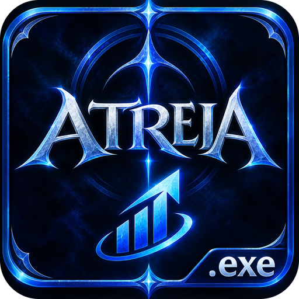

<p align="center">
  
</p>

<h1 align="center">AtreiaDPS</h1>

<p align="center">Medidor de DPS em overlay para o <b>AION 2</b> (Global), com leitura passiva da rede.</p>

## O que faz

- **Overlay sempre por cima do jogo**, sem roubar o foco: dano total desde o último clean, DPS e % de cada jogador
- **Só lutas de boss** e **só o seu grupo** (sozinho: só você), os dois configuráveis
- **Emblema e cor por classe**, **GS e CP** (pela lista do grupo ou pelo site oficial de personagens)
- **Dano por skill** ao clicar num jogador
- **Dano de invocações** (ex.: espíritos do Elementalista) creditado ao dono
- **Bolinha de ritmo do boss**: compara a vida que o boss perdeu com o tempo-alvo
- **Histórico das lutas**, atalhos globais editáveis, redimensionável, opacidade ajustável

## Instalar

1. Instale o [Npcap](https://npcap.com/#download), com as opções padrão.
2. Baixe e rode o `AtreiaDPS-Setup.exe`.
3. Deixe o jogo em modo **janela sem borda** e abra o AtreiaDPS, de preferência antes de logar no personagem.

O AtreiaDPS só **lê** o tráfego de rede do próprio jogo (via Npcap). Ele não lê nem altera a memória do jogo e não envia nada para ele. Mesmo assim, ferramentas de terceiros podem ir contra os termos do jogo: use por sua conta e risco.

## Como funciona

1. `Capture/GameCapture.cs`: acha as conexões TCP do `AION2.exe`, abre o adaptador certo no Npcap e reconhece o fluxo do jogo pelo heartbeat `0E 00 36`.
2. `Capture/TcpReassembler.cs`: remonta o stream TCP em ordem.
3. `Protocol/FrameDecoder.cs`: separa os frames (`varint tamanho, opcode(2) + corpo`, ou bundles `FF FF u32 + LZ4`).
4. `Protocol/PacketParser.cs`: dano `04 38`, DoT `05 38`, personagem `33 36`, jogadores `45 36`, spawns `41 36`, status `00 8D`, grupo `02 97`, ligação de id `20 36`.
5. `Meter/CombatMeter.cs`: lutas, identidades (grupo, invocações), DPS e skills.
6. `Meter/Armory.cs`: GS/CP pelo site oficial (`aion2.plaync.com`), com cache.
7. `UI/`: overlay e configurações desenhados à mão (WinForms).

## Compilar

Requer o [.NET 9 SDK](https://dotnet.microsoft.com/download).

```bash
dotnet run --project AionDps -c Release
```

Instalador e zip portátil (requer o [Inno Setup 6](https://jrsoftware.org/isinfo.php)):

```bash
powershell -ExecutionPolicy Bypass -File AionDps/installer/build-installer.ps1
```

Os arquivos saem em `release/`. Opções de diagnóstico: `--debug` (estado e pacotes de identidade em log) e `--dump` (todos os pacotes).

## Créditos e licença

O formato do protocolo e os dados do jogo (`AionDps/data`: skills, NPCs, emblemas de classe) vêm do projeto open-source
[cyberbadger6969/aion2-dps-meter](https://github.com/cyberbadger6969/aion2-dps-meter) (GPL-3.0). Veja `AionDps/data/NOTICE.md`.

Este projeto também é distribuído sob a **GPL-3.0**: veja [LICENSE](LICENSE).

AION é marca registrada da NCSOFT. Este projeto não tem relação com a NCSOFT.
